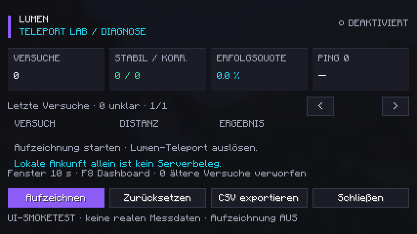

# Prüfbericht – 15.10.2026

## Bestanden

| Prüfung | Ergebnis |
| --- | --- |
| Java 21: reiner Kern und Simulationen | 30 Java-/CSV-Prüfungen bestanden |
| Forge 57.0.3 / Minecraft 1.21.7 | Vollständiger Gradle-Build mit EventBus-Validator bestanden; installierbare eigenständige Mod-JAR erstellt |
| Python / Pandas 3.0.5 | 8 synthetische Versuche, 1.456 Ereignisse eingelesen; Schema gegen Dokumentation, Spaltenreihenfolge, Datentypen, UTC, IDs, Sortierung und alle Status validiert |
| Echte Minecraft-Oberfläche neben Lumen v29 | Client erfolgreich gestartet, Dashboard gerendert, Screenshot gespeichert, Client automatisch sauber beendet |
| Tatsächlicher optionaler Lumen-Mixin | `TeleportService` im laufenden Forge-Client geladen und transformiert; `javap` bestätigt HEAD- und RETURN-Callbacks |
| Privater Zielrecord / abgewiesener Aufruf | Accessoren des tatsächlichen Lumen-Records zur Laufzeit lesbar; Aufruf ohne Welt korrekt abgewiesen und **kein** Versuch erzeugt; Hook wurde ausgeführt |
| Vanilla-Positionsmixin | `ClientPacketListener` im laufenden Client geladen und transformiert; `javap` bestätigt Callback nach `handleMovePlayer` |
| Ohne Lumen-JAR | Eigenständiger Forge-Client gestartet, optionales Ziel übersprungen, Dashboard-Screenshot gespeichert, sauber beendet |
| Datenschutz im Export | Keine Rohadresse des Testservers; HMAC-Kennung; keine Namen/Spieler-UUIDs in den Modellen oder Exportspalten |



Der UI-Test verwendet eine isolierte Entwicklungsinstallation unter `forge/run`. Er betritt keine reale Welt und sendet keine Teleportversuche an fremde Server. Die Testklasse liegt unter `forge/src/smoke` und wird zusätzlich ausdrücklich aus der ausgelieferten JAR ausgeschlossen.

## Simulierte Fälle

- Standardmäßig ausgeschaltete Aufzeichnung.
- Stabile Zielankunft mit expliziter Serverposition und Kontrollpunkten bei 1/3/5/10 Sekunden.
- Nur lokale Zielankunft ohne Serverbeleg → `TIMEOUT`.
- Rücksetzung nach sechs Sekunden trotz vorherigem Serverbeleg.
- Erste verspätete Korrektur nach 9,5 Sekunden.
- Teilbewegung und unveränderte Ausgangsposition.
- Disconnect, Aufzeichnungsstopp und Sitzungswechsel → nachvollziehbares `UNKNOWN`.
- Nächster Versuch beendet bisherige Zuordnung; eindeutige IDs bei aufeinanderfolgenden Versuchen.
- Messlücken, verspäteter Endtick, fehlender Endsample und Uhrzeit-Rücksprung.
- Verlassen und erneutes Erreichen des Ziels; zu späte Ankunft nach frühen Kontrollpunkten.
- Passende Serverposition wird nicht als Korrektur gezählt.
- Dimensionsunterschied verhindert falsche Ankunft; erwarteter Einzelspieler-Dimensionswechsel funktioniert im Kernmodell.
- Unbekannter Ping bleibt leer, ungültige Konfiguration wird abgewiesen.
- Erfasster Methodeneintritt bleibt trotz späterer Annahme als Start erhalten.
- HMAC-Normalisierung, unterschiedliche Schlüssel, begrenzte Historie und inklusiver Quotennenner.
- CSV-Escaping von Unicode, Komma, Anführungszeichen, Zeilenumbruch, Nullwerten und Dezimalpunkt.

Beispielverteilung: 2 × `SUCCESS_STABLE`, 2 × `CORRECTED`, 1 × `PARTIAL`, 1 × `TIMEOUT`, 2 × `UNKNOWN`. Diese Beispiele sind vollständig synthetisch und belegen keine Erfolgsquote realer Lumen-Teleports.

## Noch nicht durch Live-Teleports geprüft

Es wurden keine tatsächlichen Wegpunktteleports in einer Minecraft-Welt und keine Server-Rollbacks über eine reale Verbindung ausgelöst. Die Annahme eines echten F6/F5/Zurück-Aufrufs, die Zuordnung echter relativer Positionspakete, Tod/Respawn im Spiel und Einzelspieler-Dimensionswechsel benötigen noch die in [INTEGRATION.md](INTEGRATION.md) genannten Laufzeitversuche. Die Auswertung dieser Fälle wurde mit simulierten Daten getestet; der tatsächliche Mixin-Einbau und die Lesbarkeit des Zielrecords wurden separat im echten Client geprüft.

## Reproduktion

```powershell
.\tools\test-core.ps1
.\gradlew.bat build
python tools/validate_csv.py
# Automatischer UI-Smoketest; Screenshot unter forge/run/screenshots, danach beendet sich der Testclient:
.\gradlew.bat :forge:runClient -Psmoke
```

Für den Test neben Lumen dessen bestehende JAR in `forge/run/mods` legen; für den Test ohne Lumen diesen Ordner leer lassen. Es wird keine Lumen-JAR mitgeliefert. In dieser eingeschränkten Windows-Umgebung wurde der in `tools/build-restricted.ps1` dokumentierte javac-/JVM-Modus verwendet. Für den Offline-Clientstart wurden vorhandene Mojang-Metadaten aus dem lokalen Lumen-Build verwendet und der sonst netzwerkabhängige Task `:forge:downloadMCMeta` übersprungen. Das ändert keinen Modcode und keine Teleportlogik.

Die Umgebung blockierte DNS-Abfragen an Mojang und einige lokale Loopback-Verbindungen. Dadurch gab es Warnungen für Online-Authentifizierung und Forge-Versionsprüfung; die abschließenden UI-Testläufe und der Build waren trotzdem erfolgreich. Ein authentifizierter Mehrspieler-Verbindungstest wird damit nicht behauptet.
